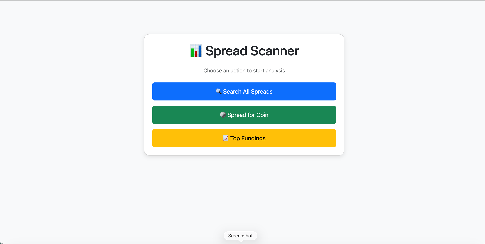
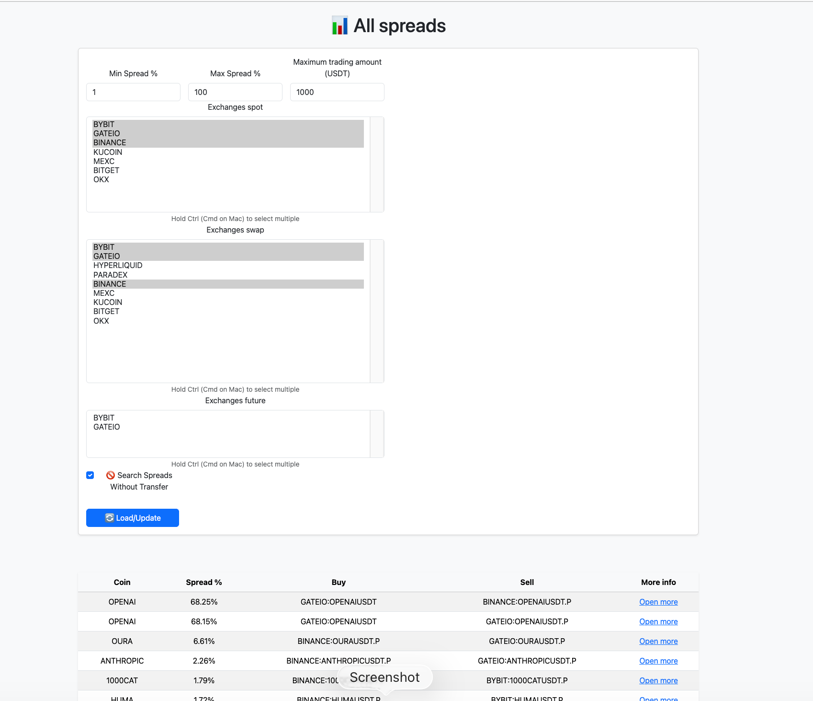
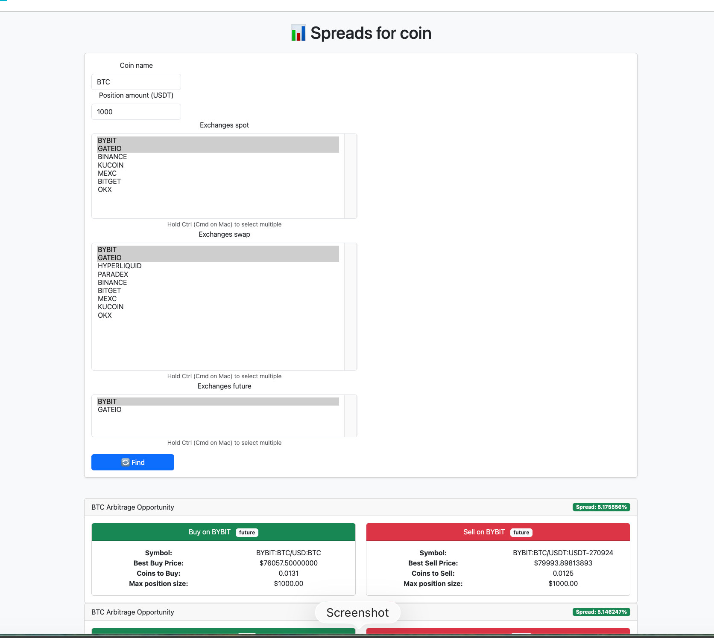
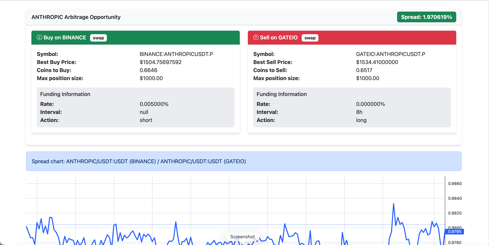
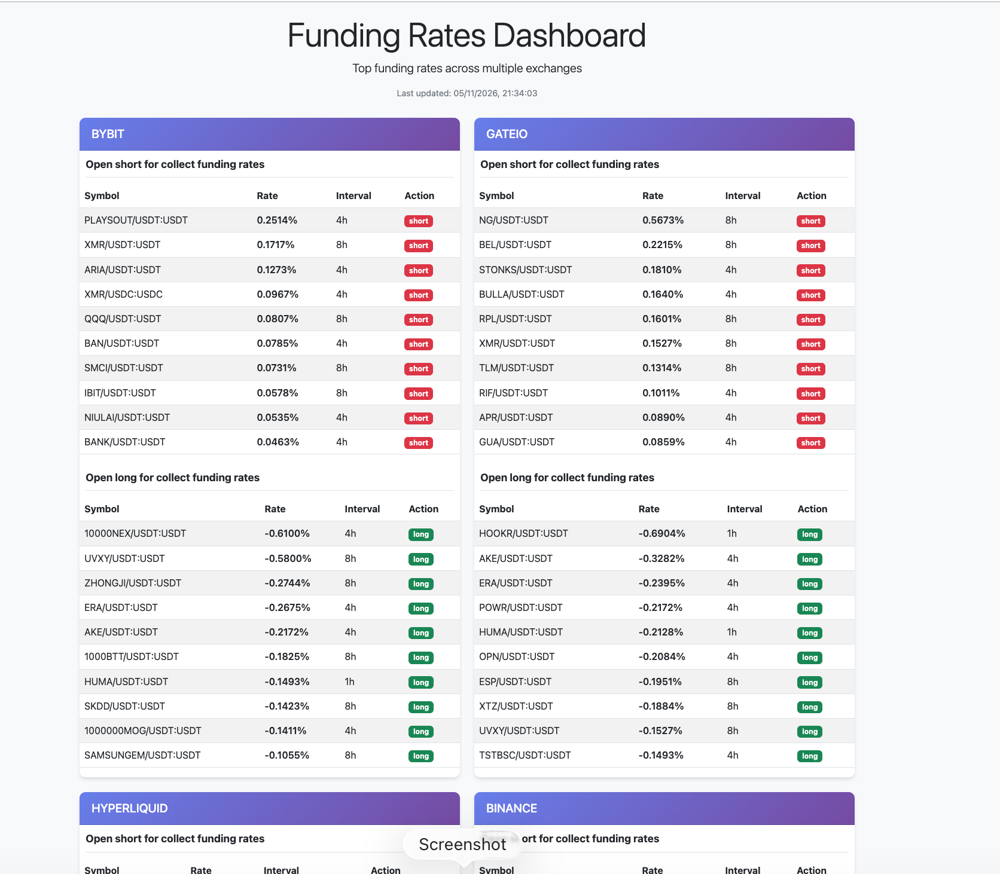

# Crypto Spread & Arbitrage Scanner

A lightweight web application built with Python and FastAPI to scan, analyze, and check cryptocurrency arbitrage spreads, order book depths, and funding rates across multiple centralized and decentralized exchanges.

---

## 📸 Preview

### 🏠 Main Dashboard
<p align="center">
  
</p>

### 📊 All Spreads & Filters
<p align="center">
  
</p>

### 🪙 Spreads for Coin
<p align="center">
  
</p>

### 🔍 Order Book Depth & Spread Chart (`More Info`)
<p align="center">
  
</p>

### 💰 Funding Rates Dashboard
<p align="center">
  
</p>

---

## Features

- **Global Spread Search**: Scan the market by clicking a button to find arbitrage spreads between exchanges based on last prices.
- **Coin-Specific Search**: Analyze spreads for a specific coin name with a custom position amount in USDT.
- **Order Book Depth Analysis**: Click on any specific trading pair to view detailed information, including order book depth calculations (default set for a $1000 position size) and historical spread charts.
- **Funding Rates Dashboard**: Monitor the highest and lowest funding rates across multiple supported exchanges to spot potential funding fee opportunities.

---

## Tech Stack

- **Backend**: Python, FastAPI, Uvicorn, CCXT library
- **Frontend**: HTML5, CSS3, JavaScript, Bootstrap 5, Lightweight Charts

---

## Quick Start & Installation

### 1. Run with Docker Compose
```bash
# Build and start
docker-compose up --build

# Start in background
docker-compose up -d

# Start without rebuild
docker-compose up
```

### 2. Stop Docker containers
```bash
# Stop containers
docker-compose down

# Stop and remove volumes
docker-compose down -v

# Stop and remove images
docker-compose down --rmi all
```

### 3. Endpoints
```
http://127.0.0.1:8000/
http://127.0.0.1:8000/docs
```

## Commands

### 1. Activate create virtual env
```
python -m venv .venv
```

### 2. Install/remove dependencies
```
pip install -r requirements.txt

pip uninstall -r requirements.txt
```

### 3. How to run web app (dev mode)
```
uvicorn src.main_web:app --port 8000
```

